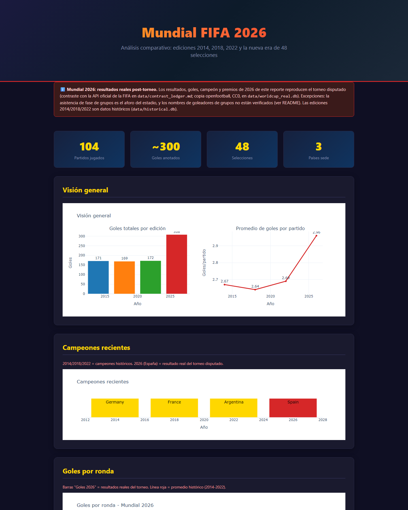

# Mundial 2026 — Análisis de los resultados reales del torneo (post-torneo)

> ℹ️ **PROCEDENCIA DE LOS DATOS (auditoría 2026-10)** — `data/worldcup.db` (104 partidos) fue construida **después** de disputado el torneo (junio–julio 2026; `src/seed_data.py` entró al repo el 2026-07-29, diez días después de la final) y **reproduce los resultados reales**: fixtures, fechas, sedes, grupos, marcadores, penales y premios oficiales. Las 104 alineaciones y marcadores son idénticos a `data/worldcup_real.db` (openfootball, CC0, 308 goles) y contrastan con la API oficial de FIFA ([`data/contrast_ledger.md`](data/contrast_ledger.md)).
>
> **Qué NO es oficial dentro de `worldcup.db`** (detalle en [Auditoría de campos](#auditoría-de-campos-auditoría-2026-10)): la asistencia de los 72 partidos de fase de grupos es el **aforo del estadio**, no la asistencia oficial (la de eliminatorias sí coincide con FIFA en 32/32), y los **nombres de goleadores de fase de grupos no son confiables** (54/72 discrepan de openfootball; verificaciones puntuales contra reportes de FIFA confirman errores). Todo lo demás —resultados, grupos, standings, premios— es real.

Después de que España levantara la copa en MetLife (1-0 en tiempo extra sobre Argentina), me quedé con la duda: ¿qué tan diferente fue este Mundial de 48 selecciones comparado con los anteriores? Armé este proyecto para responder eso con datos, no con opiniones.


[](https://github.com/alvarosalinaso/worldcup-2026/actions/workflows/ci.yml)
[](#tests)
[](LICENSE)

---

## Las preguntas que me hice

Todo empezó con cosas que quería saber y no encontraba fáciles de responder:

1. **¿Cómo se comparan los Mundiales?** Quería ver si el formato de 48 equipos cambió algo real en goles, asistencia o paridad.
2. **¿Qué estadios funcionaron mejor?** No solo capacidad, sino ocupación real y demanda.
3. **¿Los debutantes tienen alguna chance?** Cabo Verde, Curazao, Jordania y Uzbekistán estuvieron ahí, pero ¿les fue bien o mal?

---

## Qué hay aquí

Una base de datos SQLite con todo el torneo: 48 selecciones, 16 estadios, 104 partidos, 308 goles — una reproducción post-torneo de los resultados reales (con las reservas de [Auditoría de campos](#auditoría-de-campos-auditoría-2026-10) para asistencia de grupos y goleadores de grupos). Después, un montón de consultas SQL que van desde "quién hizo más goles" hasta análisis de clustering y sensibilidad.

### Esquema de la base de datos

```
teams           ← nombre, confederación, ranking FIFA, si es debutante
venues          ← estadio, ciudad, país, capacidad, región
groups          ← grupo A a L
group_standings ← posiciones finales de cada grupo
matches         ← todos los partidos con marcador y asistencia
goals           ← goleador, equipo, si fue autogol
awards          ← Balón de Oro, Bota de Oro, Guante de Oro, Fair Play
```

### Qué hice con los datos

| Qué | Cómo | Para qué |
|-----|------|----------|
| Carga e ingesta | `seed_data.py` | Poblar SQLite con los resultados reales del Mundial 2026 (reproducción post-torneo) |
| 16 consultas analíticas | `queries.py` + Pandas | Responder las preguntas de arriba |
| Clustering | K-Means | Agrupar estadios por patrones de uso |
| Forecasting | ARIMA | Ilustrativo: requiere serie histórica suficiente (≥5 obs); con la asistencia por mundial actual (n=3) se omite y se documenta |
| Ranking compuesto | Z-scores | Comparar estadios de forma justa |
| Monte Carlo (N=1000) | Simulación estocástica | Ver qué tan sensibles son los resultados |
| Correlaciones | Pearson | Encontrar relaciones entre variables |

---

## Datos reales del torneo (openfootball, CC0)

El Mundial 2026 se disputó (junio–julio 2026) y los resultados **reales** de los
104 partidos (grupos A-L, octavos, cuartos, semis, 3er lugar y final) viven en dos
copias dentro del repo:

- `data/worldcup.db` — base principal, poblada por `src/seed_data.py` **después** del torneo, con los resultados ya conocidos.
- `data/worldcup_real.db`, tabla `matches_real` — copia independiente ingesta durante la auditoría 2026-10 desde openfootball (commit upstream fijado). Es equivalente a `worldcup.db`: fixtures, fechas, grupos y marcadores idénticos (solo difieren en alias de nombres/venues: "USA" = "United States", etc.).

Fuente común de ambas:

- **Fuente**: [openfootball/worldcup → `2026--canada-usa-mexico`](https://github.com/openfootball/worldcup/tree/master/2026--canada-usa-mexico) (formato Football.TXT)
- **Licencia**: [CC0-1.0](https://github.com/openfootball/worldcup/blob/master/LICENSE.md) (dominio público; la citamos aunque la CC0 no lo exige)
- **Reproducción**: `python src/ingest_real_data.py` descarga (si faltan) los `.txt`
  a `data/openfootball/`, los parsea, valida invariantes (104 partidos, 72 de
  grupos, 308 goles marcadores, final España 1-0 Argentina en prórroga) y reescribe
  `data/worldcup_real.db` con la procedencia (URL, commit fijado, sha256 de los
  archivos) en la tabla `meta`. Los `.txt` están en el repo para correr offline.
- **Contraste oficial**: los resultados reales se verificaron contra la API de FIFA
  (`api.fifa.com`, temporada 285023): final y 3er lugar coinciden, 32 marcadores de
  eliminatoria idénticos, 104 partidos y 308 goles en ambas fuentes. Ledger con
  URL y fecha de acceso: [`data/contrast_ledger.md`](data/contrast_ledger.md)
  (regenerable con `python src/verify_against_fifa.py`).

---

## Auditoría de campos (auditoría 2026-10)

Qué campos de `data/worldcup.db` son datos oficiales y cuáles son generados/estimados:

| Campo | Veredicto | Evidencia |
|---|---|---|
| `matches` (fixtures, fechas, sedes, grupos, marcadores, penales, prórroga) | **Real** | 104/104 idénticos a openfootball (`worldcup_real.db`) y a la API FIFA (0 discrepancias de marcador) |
| `group_standings` | **Real (derivado)** | recalculado desde los partidos: 0 discrepancias |
| `awards` (9 premios) | **Real** | Rodri (Balón de Oro), Messi (Plata), Mbappé (Bronce + Bota, 10 goles), Simón (Guante), Cubarsí (Joven), Fair Play Países Bajos — verificados contra el anuncio oficial FIFA y prensa del 19-07-2026 |
| `matches.attendance` en eliminatorias (32 partidos) | **Real** | 32/32 idéntico al campo `Attendance` de la API FIFA |
| `matches.attendance` en fase de grupos (72 partidos) | **Sintético (estimado)** | igual al aforo exacto del estadio en los 72; difiere de la asistencia oficial de FIFA en 29/72 (suma DB 6.825.316 vs oficial FIFA 6.810.966) |
| `goals` (totales por partido y equipo) | **Real** | la suma de goles cuadra con el marcador en 104/104 partidos |
| `goals.scorer` en eliminatorias | **Real en 31/32** | único error: cuartos Argentina 3-1 Suiza (la DB dice Messi; el gol real lo hizo Lautaro Martínez — FIFA/ESPN/AP) |
| `goals.scorer` en fase de grupos | **No confiable** | 54/72 partidos tienen al menos un nombre distinto de openfootball; verificaciones puntuales vs reportes de FIFA confirman la DB está mal: MEX 1-0 KOR (real: Luis Romo; DB: Jiménez), USA 4-1 PAR (real: Bobadilla og, Balogun ×2, Reyna, Mauricio; DB: Tillman/Trusty/Enciso) |
| `teams.debut` (4 debutantes) | **Real** | Jordania, Uzbekistán, Cabo Verde y Curazao |
| `teams.fifa_ranking` | **Parcialmente verificado** | #1 Argentina = ranking FIFA del 10-06-2026 (previo al torneo); el resto de posiciones no se contrastó una a una |
| `stadiums` (aforos de 16 estadios) | **Real** | capacidades de los estadios sede |

Auditoría reproducible: comparar `matches`/`goals` contra `worldcup_real.db` y
contra la API FIFA (`src/verify_against_fifa.py`), y los goleadores contra los
`.txt` de `data/openfootball/` (que incluyen minutos y autores).

---

## Lo que encontré

El Mundial 2026 fue, en números, una bestia: **6,8 millones de asistentes** en 104 partidos (6.825.316 en la DB; la cifra oficial de FIFA suma 6.810.966 — la diferencia viene de la asistencia de grupos tomada como aforo). **España se coronó campeón venciendo a Argentina 1-0 en la final (tiempo extra)**, y Mbappé se quedó con la Bota de Oro de 10 goles.

Lo más interesante: **Europa y Sudamérica dominaron los cuartos de final** con el 75% de los cupos, pese a que el torneo se amplió a 48 selecciones. Los debutantes no tuvieron un mal rendimiento, pero tampoco llegaron lejos.

> **Nota**: los resultados, premios y goleadores de eliminatorias son los oficiales del torneo disputado. Las dos reservas de este dataset son la asistencia de fase de grupos (= aforo) y los nombres de goleadores de fase de grupos (sin verificar; ver [Auditoría de campos](#auditoría-de-campos-auditoría-2026-10)).

---

## Visualizaciones

### Bracket interactivo (Observable)

<div style="position:relative;padding-bottom:56.25%;height:0;overflow:hidden;max-width:100%;">
  <iframe src="https://observablehq.com/@alvarosalinaso/worldcup-bracket" title="Bracket — World Cup 2026" style="position:absolute;top:0;left:0;width:100%;height:100%;border:0;" loading="lazy" allowfullscreen></iframe>
</div>

### Mapa de asistencia por sede (Datawrapper)

<div style="position:relative;padding-bottom:56.25%;height:0;overflow:hidden;max-width:100%;">
  <iframe src="https://datawrapper.dwcdn.net/HLIEG/" title="Asistencia por Sede — World Cup 2026" style="position:absolute;top:0;left:0;width:100%;height:100%;border:0;" loading="lazy" allowfullscreen></iframe>
</div>

---

## Dashboard y reportes

El proyecto tiene tres formas de ver los datos, cada una con su propósito:

- **Reporte HTML estático** (`docs/index.html`) — Abre el archivo y listo, no necesita servidor. Bueno para un vistazo rápido.
- **Dashboard Dash** (`dashboard/app.py`) — Más interactivo, con filtros y tabs. Ideal para explorar.
- **API Flask** (`api/server.py`) — Si quieres construir tu propia visualización encima.

```bash
# Reporte estático
python src/generate_report.py
# Abre docs/index.html

# Dashboard Dash
python dashboard/app.py
# http://localhost:8050

# API Flask
python api/server.py
# http://localhost:5000
```

## Captura



---

## Cómo correr esto

```bash
git clone https://github.com/alvarosalinaso/worldcup-2026.git
cd worldcup-2026
pip install -r requirements.txt
python src/seed_data.py          # Crea la base de datos
python src/export_visualizations.py  # Genera los archivos de exportación
```

### Tests

```bash
pip install -r requirements-dev.txt
pytest --cov=. --cov-report=term-missing
```

La suite tiene cobertura ≥60% sobre el core testeable (scripts de visualización/reporte/seed excluidos del gate) y corre contra Python 3.10–3.13 en CI.

### Stack

| Capa | Qué usé | Por qué |
|------|---------|---------|
| Datos | SQLite 3 | Simple, portátil, no necesita servidor |
| Procesamiento | Python + Pandas | El estándar para análisis de datos |
| Visualización | Plotly | Interactiva y se ve bien |
| CI/CD | GitHub Actions | Automatización básica pero efectiva |

---

## Estructura

```
worldcup-2026/
├── src/
│   ├── schema.sql              ← DDL de las 7 tablas
│   ├── seed_data.py            ← Donde se meten los datos
│   ├── queries.py              ← Las 16 consultas analíticas
│   ├── generate_report.py      ← Genera el HTML estático
│   ├── generate_tables.py      ← Tabla ejecutiva con great_tables
│   ├── clustering_analysis.py  ← K-Means
│   ├── forecasting.py          ← ARIMA
│   ├── ranking_analysis.py     ← Z-scores
│   ├── optimization_analysis.py ← Capacidad vs demanda
│   ├── sensitivity_analysis.py ← Monte Carlo
│   └── statistical_tests.py    ← Correlaciones
├── dashboard/
│   └── app.py                  ← Dashboard Dash
├── api/
│   ├── server.py               ← API Flask
│   └── static/index.html       ← Frontend
├── data/
│   ├── worldcup.db             ← Base de datos principal
│   └── historical.db           ← Datos de 2014, 2018, 2022
├── docs/
│   └── index.html              ← Reporte estático
├── tests/
│   └── test_queries.py         ← Suite de tests
└── requirements.txt
```

---

## Datos que incluye

- 48 selecciones con confederación y ranking FIFA
- 16 estadios en USA, México y Canadá
- 12 grupos (A a L) con posiciones
- 104 partidos con marcador, asistencia (oficial en eliminatorias, aforo del estadio en grupos) y si hubo tiempo extra/penales
- 308 goles con goleador y equipo (totales reales; nombres de goleadores de fase de grupos sin verificar)
- Datos históricos de los Mundiales 2014, 2018 y 2022

---

## Proyectos relacionados

- [Manchester United Analysis](https://github.com/alvarosalinaso/manchester-united-analisis) — Análisis del rendimiento del United 2014-2024
- [Passing Network Analysis](https://github.com/alvarosalinaso/united-passing-efficiency-24-25) — Red de pases y eficiencia del mediocampo
- [Portfolio Web](https://github.com/alvarosalinaso/portfolio-web) — Mi portafolio personal

---

**Álvaro Salinas** — Proyecto personal de análisis de datos deportivos
